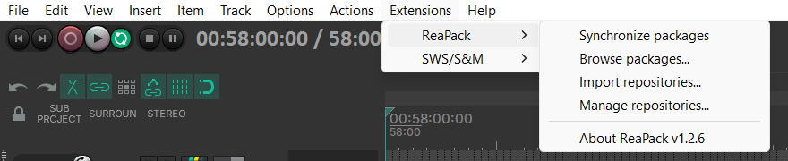
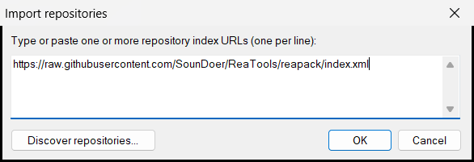
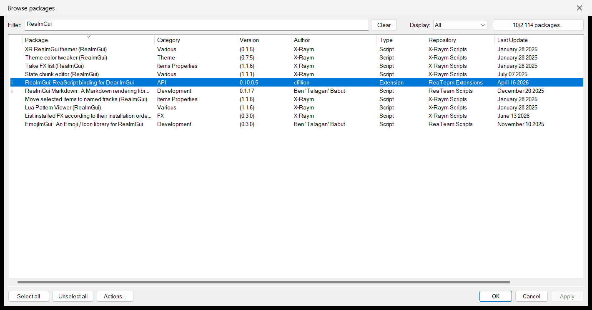
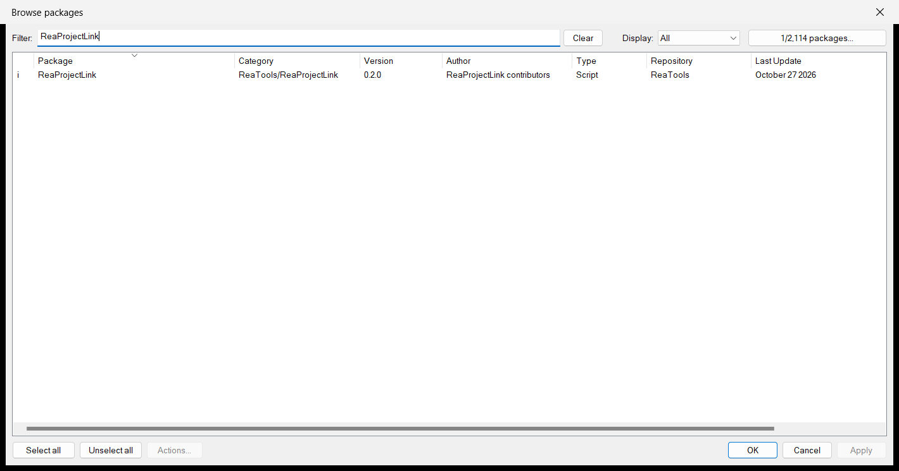
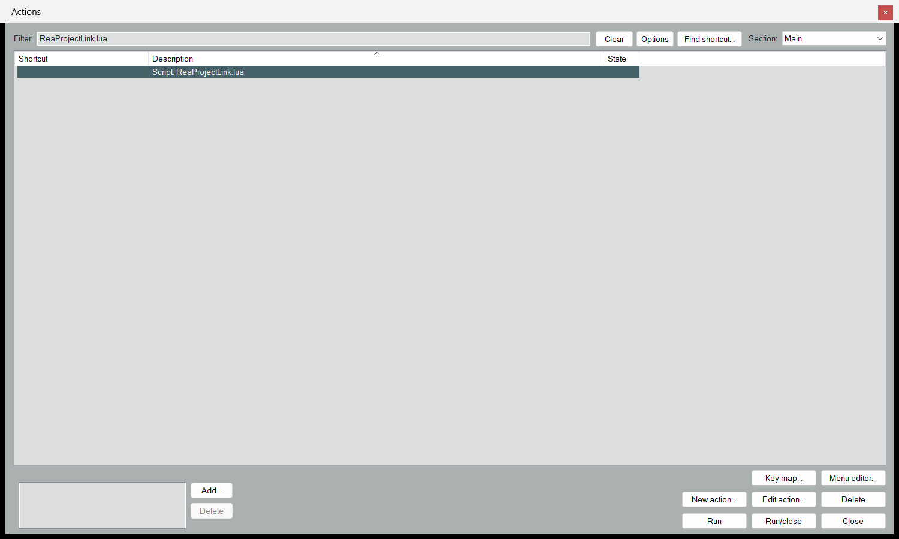
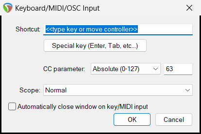
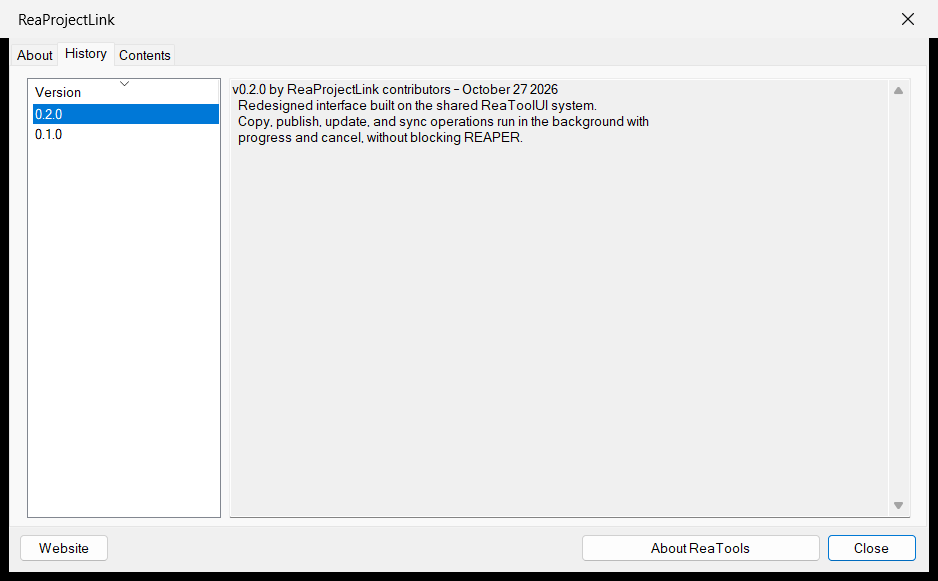
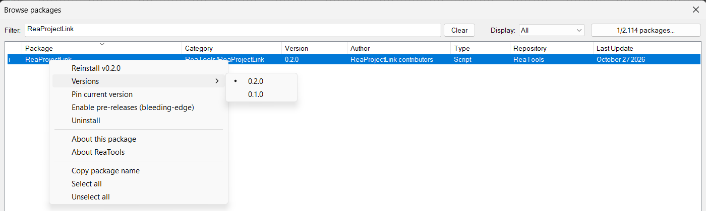

# 安装与更新 ReaTools

ReaTools 是一组 REAPER 工具，目前包括 ReaProjectLink。所有工具都通过 ReaPack 安装和更新，不需要手动复制脚本文件。

本篇按顺序讲：

1. 准备环境
2. 添加 ReaTools 仓库
3. 安装工具
4. 打开工具并设置快捷键
5. 更新
6. 查看版本与回滚
7. 常见问题

## 1. 准备环境

| 需要 | 版本要求 | 说明 |
|------|----------|------|
| REAPER | 7.74 或更新 | 在 `Help > About REAPER` 里可以看到当前版本 |
| ReaPack | 任意近期版本 | REAPER 的扩展包管理器，负责安装和更新 ReaTools |
| ReaImGui | 0.9 或更新 | ReaTools 的界面依赖它，通过 ReaPack 安装 |

### 安装 ReaPack

如果 REAPER 的 `Extensions` 菜单里已经有 `ReaPack`，说明已经装好了，可以跳过这一步。

1. 打开 [reapack.com](https://reapack.com/)，下载与你的系统对应的文件（Windows 64 位是 `reaper_reapack-x64.dll`）。
2. 在 REAPER 里选择 `Options > Show REAPER resource path in explorer/finder...`，打开资源目录。
3. 把下载的文件放进资源目录下的 `UserPlugins` 文件夹。
4. 重启 REAPER。

装好后，`Extensions > ReaPack` 菜单是这样的：



## 2. 添加 ReaTools 仓库

ReaPack 默认不知道 ReaTools 在哪，需要先告诉它仓库地址。这一步每台电脑只做一次。

1. 选择 `Extensions > ReaPack > Import repositories...`。
2. 粘贴下面的地址，点 `OK`：

```text
https://raw.githubusercontent.com/SounDoer/ReaTools/reapack/index.xml
```



> 如果这个仓库之前已经添加过，点 `OK` 后不会有任何提示，这是正常的。可以在 `Extensions > ReaPack > Manage repositories...` 里确认列表中有 `ReaTools`。

## 3. 安装工具

1. 选择 `Extensions > ReaPack > Browse packages...`。
2. 在 `Filter` 里输入 `ReaImGui`，找到 `ReaImGui: ReaScript binding for Dear ImGui`，右键选择 `Install`。

   

3. 把 `Filter` 改成 `ReaProjectLink`，右键选择 `Install`。它的 `Repository` 一栏显示 `ReaTools`。

   

4. 点 `Apply` 或 `OK`，等待下载完成。
5. 如果这次安装了 ReaImGui，重启 REAPER。

> 列表最左侧出现 `i` 表示这个包已经安装。

## 4. 打开工具并设置快捷键

ReaProjectLink 安装后会出现在 Action List 里，名称是 `Script: ReaProjectLink.lua`。

1. 选择 `Actions > Show action list...`。
2. 在 `Filter` 里输入 `ReaProjectLink.lua`。
3. 选中 `Script: ReaProjectLink.lua`，点 `Run` 即可打开工具窗口。



每次都从 Action List 打开会比较麻烦，建议设置一个快捷键：

1. 在 Action List 里选中 `Script: ReaProjectLink.lua`。
2. 点左下角 `Shortcuts for selected action` 区域的 `Add...`。
3. 按下你想用的按键组合，点 `OK`。



> 也可以把它加到工具栏：在工具栏上右键选择 `Customize toolbar...`，再添加这个 Action。

## 5. 更新

ReaTools 发布新版本后，需要手动同步：

1. 选择 `Extensions > ReaPack > Synchronize packages`。
2. ReaPack 会下载所有已安装包的新版本，并在完成后列出更新内容。
3. 如果 ReaProjectLink 窗口开着，先关掉再重新打开，新版本才会生效。

> 如果这次同步也更新了 ReaImGui，需要重启 REAPER。

## 6. 查看版本与回滚

### 查看当前版本

在 `Browse packages` 里找到 ReaProjectLink：
- `Version` 一栏就是当前安装的版本；
- 右键选择 `About this package`，切到 `History` 标签，可以看到每个版本的更新说明。



### 回滚到旧版本

如果新版本有问题，可以临时退回旧版本：

1. 在 `Browse packages` 里右键 ReaProjectLink，选择 `Versions`，再选要安装的版本号。
2. 点 `Apply`。
3. 关掉并重新打开 ReaProjectLink 窗口。



> **回滚前先问一下维护者。** 新版本有时会改变共享目录里发布数据的格式。旧版本遇到新格式的数据时，会拒绝导入、同步和发布，并提示升级。所以回滚只适合临时排查问题，不要在项目进行中长期停留在旧版本。

回滚后，ReaPack 下次 `Synchronize packages` 时会再次升级到最新版。如果想暂时固定在旧版本，可以在右键菜单里选择 `Pin current version`。

## 7. 常见问题

**更新后还是旧的界面或行为**

先确认 `Browse packages` 里的 `Version` 已经是新版本号。如果是，关掉 ReaProjectLink 窗口再重新打开。窗口一直开着时，运行的仍是打开那一刻加载的版本。

**Action List 里找不到 `Script: ReaProjectLink.lua`**

在 `Browse packages` 里确认 ReaProjectLink 前面有 `i` 标记。如果没有，回到第 3 节重新安装。如果有，检查 Action List 右上角的 `Section` 是否是 `Main`。

**打开时提示 `Install ReaImGui 0.9 or newer through ReaPack and restart REAPER.`**

说明 ReaImGui 没有安装，或者装了还没重启 REAPER。按第 3 节安装 ReaImGui 后重启。

**打开时提示 `ReaProjectLink requires REAPER 7.74 or newer; current version is ...`**

REAPER 版本太旧，需要先升级 REAPER。
