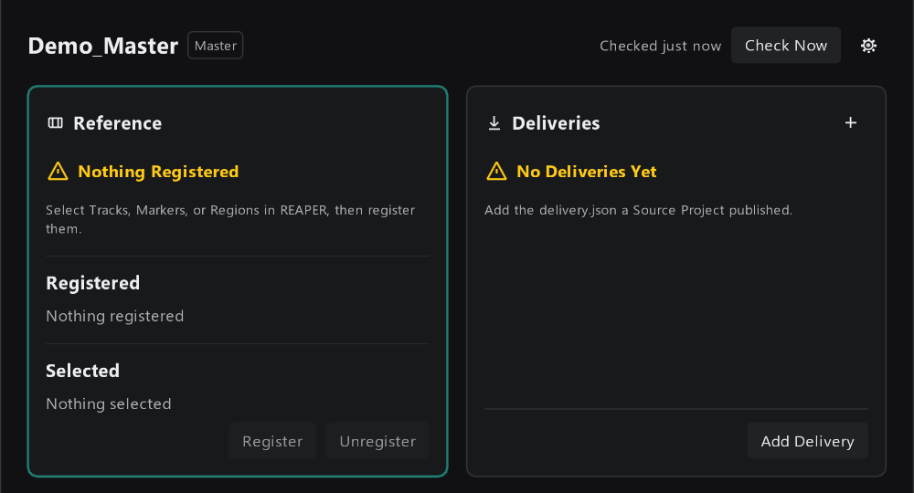
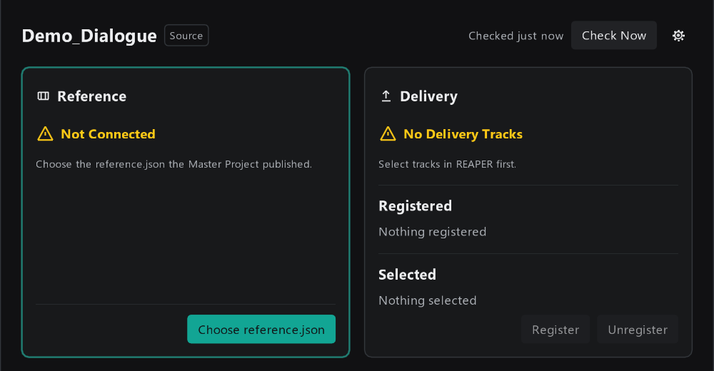
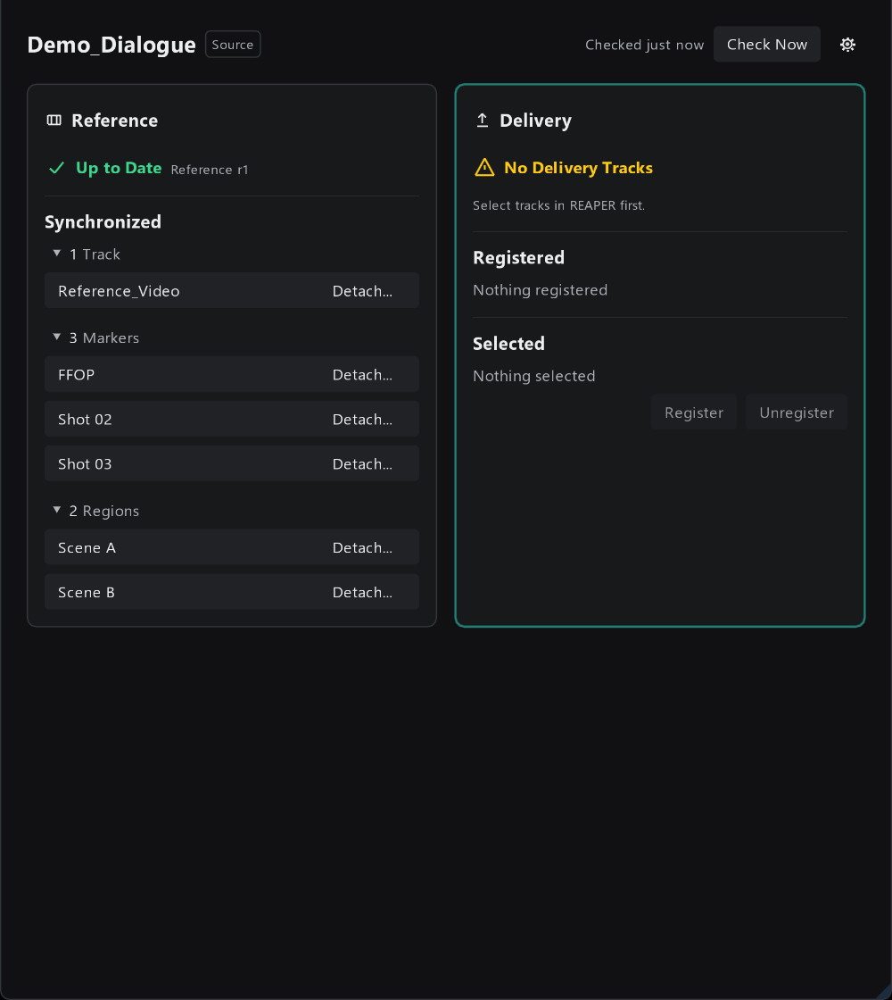
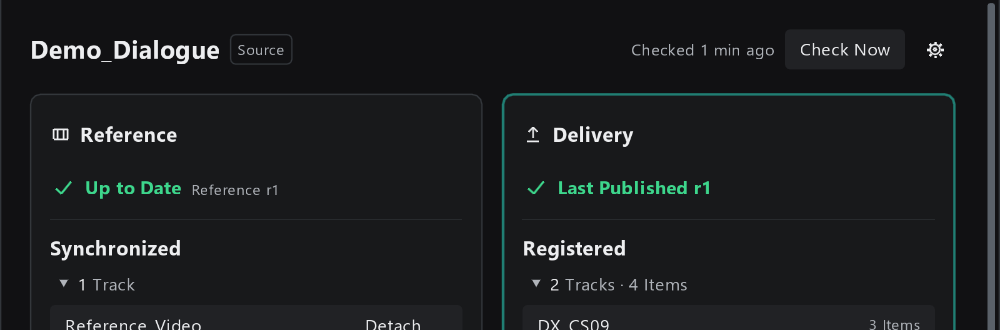
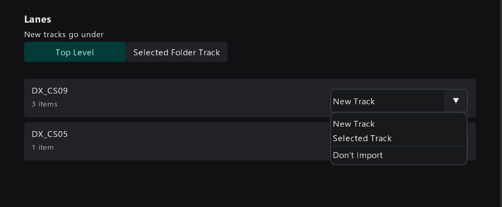
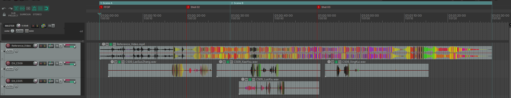

# 3. 第一次完整走一遍

这一篇带你从零开始，走完一次完整的流程：

1. 建一个 Master Project，放入画面，发布 Reference；
2. 建一个对白的 Source Project，同步 Reference，放入对白，发布 Delivery；
3. 回到 Master Project，导入这份 Delivery。

建议第一次用的时候，用两个新的测试工程完整走一遍，再用到正式项目上。

开始之前，请先按 [安装与更新 ReaTools](../../../../../docs/manual/zh-CN/install.md) 装好 ReaProjectLink，并知道怎么打开它的窗口。

> **两条必须知道的规则**
>
> - 工程要**先在 REAPER 里保存**，ReaProjectLink 才能使用。没保存的工程只会看到提示 "Save this project in REAPER to use ReaProjectLink."
> - 工程要**通过 ReaProjectLink 初始化**（下面的 `Initialize ... Project` 按钮）。另外，工程里原来就有的 Item 不会被自动认领；只有按流程 Register、Publish、Synchronize 的内容才由 ReaProjectLink 管理。

演示用的文件夹结构如下。正式项目中，这些工程要放在大家都能访问的共享位置。

```text
ReaProjectLink-Manual-Demo/
  Master/
    Demo_Master.rpp
  Dialogue/
    Demo_Dialogue.rpp
    Media/  ← 对白 WAV
```

## 第一部分：Master Project 发布 Reference

### 第 1 步：新建 Master 工程，放入画面

1. 在 REAPER 里新建工程，保存到 `Master/Demo_Master.rpp`。
2. 新建一条轨道，命名为 `Reference_Video`，把画面视频拖进去。
3. 把视频放在 `01:00:00:00`。
4. 在视频第一帧加一个名为 `FFOP` 的 Marker，再按需要加镜头 Marker（演示里是 `Shot 02`、`Shot 03`）和段落 Region（`Scene A`、`Scene B`）。

> 视频放在 01:00:00:00、首帧打 FFOP Marker 是团队的工程约定，ReaProjectLink 本身不要求。ReaProjectLink 只会把你登记的 Marker 原样同步给各部门。

### 第 2 步：初始化为 Master Project

打开 ReaProjectLink 窗口。第一次在这个工程里打开时，会看到初始化页面：


点 `Initialize Master Project`。

**你应该看到：** 工程名旁边显示 `Master`，左边是 Reference 卡片，右边是 Deliveries 卡片。Reference 显示 `Nothing Registered`，因为还没登记任何东西。



### 第 3 步：登记画面轨道、Marker 和 Region

1. 在 REAPER 里选中 `Reference_Video` 轨道。
2. 点第一个 Marker 的编号标签，再按住 `Shift`，依次点其余 Marker 和 Region 的编号标签，把它们加入选择。轨道的选择会保留。

> 不要用 `Ctrl` 点 Marker。REAPER 默认设置下，`Ctrl` + 点击 Marker 会**复制**出一个新的 Marker。

Reference 卡片下方的 Selected 会列出你选中的东西，每一行显示 `Not Registered`：


点 `Register`。

**你应该看到：** 这些内容出现在 Registered 下，状态变成 `Not Published Yet`，下面出现 `Review and Publish` 按钮。


> 为什么要手动登记？ReaProjectLink 不会猜哪些东西要发给各部门。工程里你自己临时加的 Marker、参考轨道，没登记就不会被发出去。

### 第 4 步：发布 Reference

点 `Review and Publish`，进入发布检查页面：


这里列出这次会发布的轨道、Marker、Region 的数量，点开 Contents 里的分组可以看到具体名字。确认无误后，点右下角 `Publish`。

**你应该看到：** Reference 卡片显示 `Published r1`。`r1` 是第一个 Revision。


此时 `Master/` 下多了一个 `_ReaProjectLink` 文件夹，里面的 `reference.json` 就是各部门要订阅的文件。

## 第二部分：对白 Source Project 发布 Delivery

### 第 5 步：新建对白工程并初始化

1. 新建工程，保存到 `Dialogue/Demo_Dialogue.rpp`。
2. 打开 ReaProjectLink 窗口，点 `Initialize Source Project`。

**你应该看到：** 工程名旁边显示 `Source`。左边 Reference 卡片显示 `Not Connected`，右边 Delivery 卡片显示 `No Delivery Tracks`。



### 第 6 步：订阅 Master 的 Reference

点 Reference 卡片里的 `Choose reference.json`，在文件对话框里找到 Master 工程旁边的 `_ReaProjectLink/Demo_Master/reference.json`：


**你应该看到：** Reference 卡片显示 `Reference r1 Available`，表示有一个可以同步的 Revision。


### 第 7 步：同步 Reference

点 `Review Update`，进入同步检查页面：


`Alignment` 显示 `Mirror Master Timeline`，意思是本工程会采用和 Master Project 完全相同的时间线（见 [2. 核心概念](02-concepts.md#时间线怎么对齐)）。确认后点 `Synchronize`。

**你应该看到：** Reference 卡片显示 `Up to Date Reference r1`，Synchronized 下列出同步进来的轨道、Marker、Region。



工程时间线上，画面、Marker、Region 都出现在和 Master Project 相同的位置：


> 同步进来的画面轨道、Marker、Region 由 ReaProjectLink 管理。下次 Master 发布新的 Reference 时，它们会被更新。不要在上面做自己的编辑；需要自己的 Marker，另外加就行。

### 第 8 步：放入对白

正常做你的对白工作。最终要交付的音频，需要**弹出成 WAV**，放在专门的交付轨道上。

演示里新建了两条轨道 `DX_CS09` 和 `DX_CS05`，把对白 WAV 对着画面放好。

> 交付轨道上不要挂 FX。ReaProjectLink 发布时只复制 WAV 文件本身，不会渲染 FX；检测到 FX 时会拦下发布，提醒你先 bounce。

### 第 9 步：登记 Delivery Track

在 REAPER 里选中 `DX_CS09` 和 `DX_CS05` 两条轨道。Delivery 卡片的 Selected 会列出它们：


点 `Register`。

**你应该看到：** Registered 下显示 `2 Tracks · 4 Items`，状态是 `Not Published Yet`。


之后在这两条轨道上增删、移动 Item，都会自动算进下一次发布，不需要重新 Register。

### 第 10 步：发布 Delivery

点 `Review and Publish`。ReaProjectLink 会先检查一遍媒体文件，然后显示发布检查页面：


这里要看两处：

- **数量**：这次会发布几条轨道、几个 Item。点开 Items 下的轨道可以看到每个文件名。
- **Checked Against Reference**：本次发布是对着 Reference 的哪个 Revision 做的。这里是 `r1 (Synced)`，表示你已经同步了最新的 r1。

确认后点 `Publish`。发布时会复制 WAV 文件，顶部显示进度：



**你应该看到：** Delivery 卡片显示 `Last Published r1`。


发布时工程会被自动保存。`Dialogue/` 下多了 `_ReaProjectLink/Demo_Dialogue/delivery.json`，这是 Master Project 要选的文件。

## 第三部分：Master Project 导入 Delivery

### 第 11 步：添加 Delivery

切回 Master 工程，点 Deliveries 卡片里的 `Add Delivery`，选择对白工程旁边的 `_ReaProjectLink/Demo_Dialogue/delivery.json`：


### 第 12 步：设置导入到哪些轨道

检查完媒体后，会进入导入页面。页面顶部写着这份 Delivery 是第几个 Revision、对着哪个 Reference 做的（这里是 `Delivery r1 · made against Reference r1`）。


Lanes 下每一行对应对白工程的一条 Delivery Track。右边的下拉框决定它导入到哪里：



| 选项 | 含义 |
|------|------|
| `New Track` | 新建一条轨道放这些音频 |
| `Selected Track` | 放到 Master 工程里已有的某条轨道上。先在 REAPER 里选中**一条**轨道，再选这个选项 |
| `Don't Import` | 这条暂时不导入 |

`New tracks go under` 决定新建的轨道放在哪：`Top Level` 是放在工程最外层；`Selected Folder Track` 是放进某个文件夹轨道里，同样要先在 REAPER 里选中**一条**文件夹轨道，再点这个选项。

第一次导入用默认的 `New Track` 和 `Top Level` 即可。这里的选择会被记住，之后这份 Delivery 更新时，音频会继续进同一条轨道。

点 `Import`。

**你应该看到：** 底部提示 `Imported 4 items on 2 new tracks.`，Deliveries 卡片显示 `All Up to Date`，`Demo_Dialogue` 一行显示 `Up to Date · r1`。


对白出现在 Master 工程中，位置和对白工程里完全一致：



## 走完之后

到这里，你已经走完了一个完整的来回：

- Master Project 发布了 Reference r1；
- 对白 Source Project 同步了 r1，并发布了 Delivery r1；
- Master Project 导入了对白的 Delivery r1。

接下来的日常工作就是不断重复"改 → Publish → Synchronize"：

- Master 负责人：[4. Master Project 日常操作](04-master-tasks.md)
- 各部门：[5. Source Project 日常操作](05-source-tasks.md)
