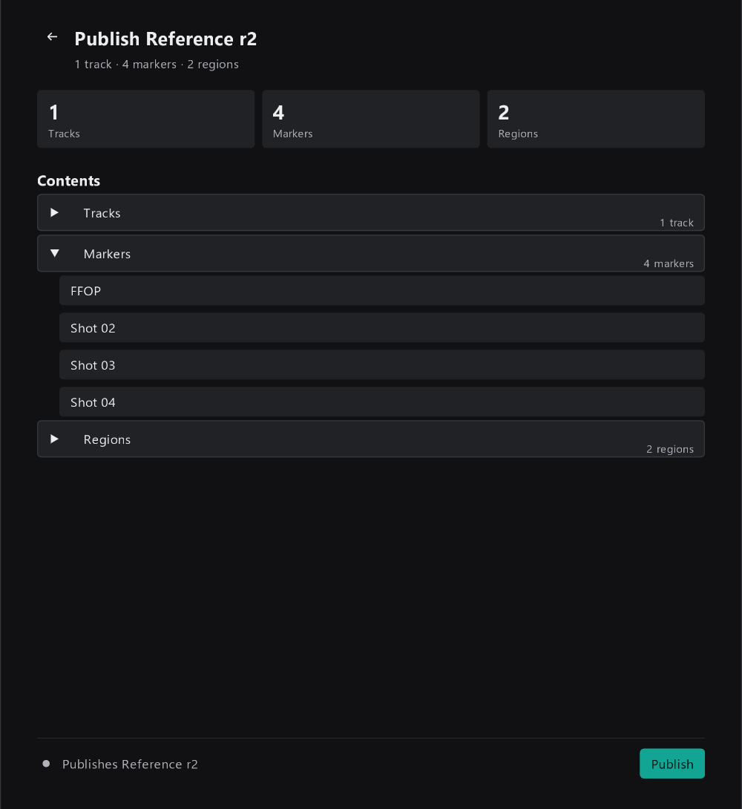
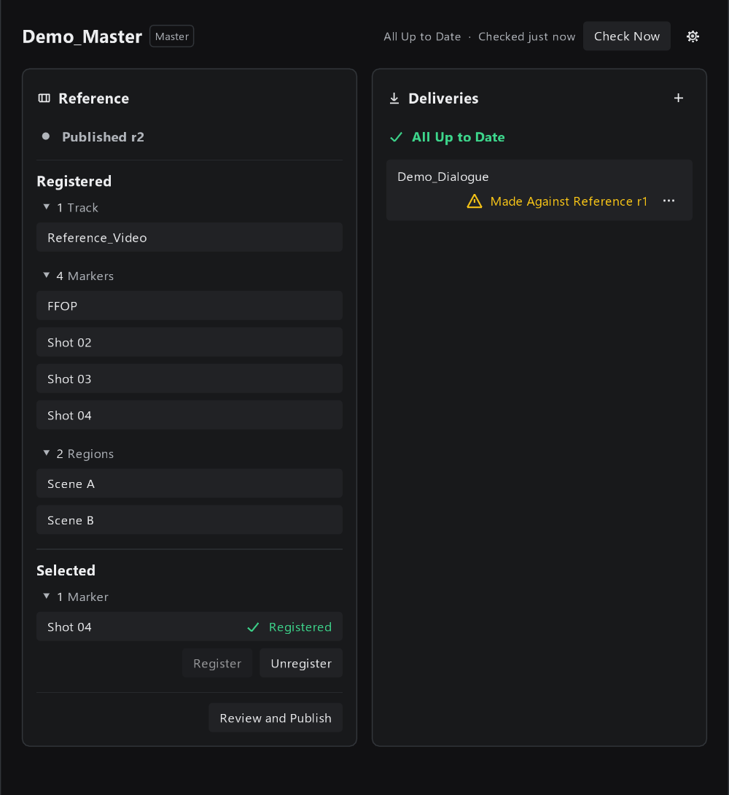
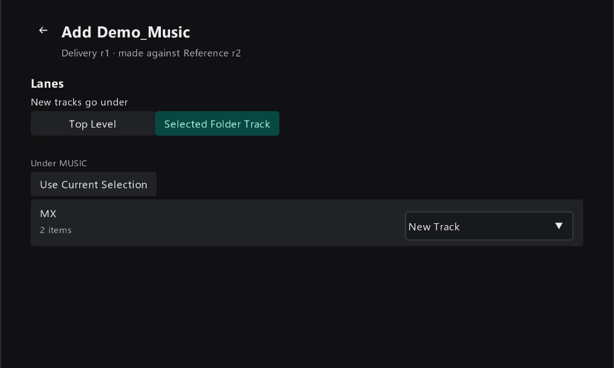
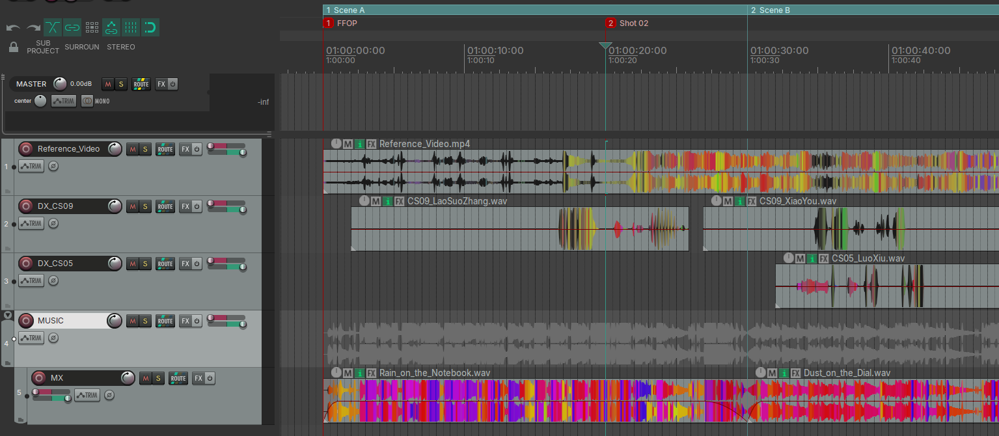
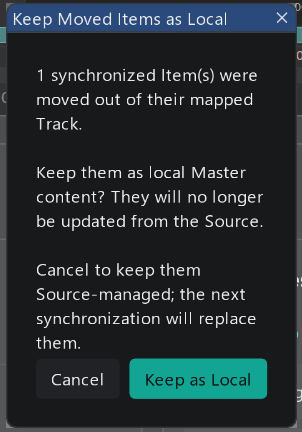
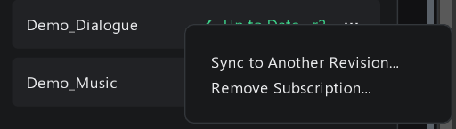
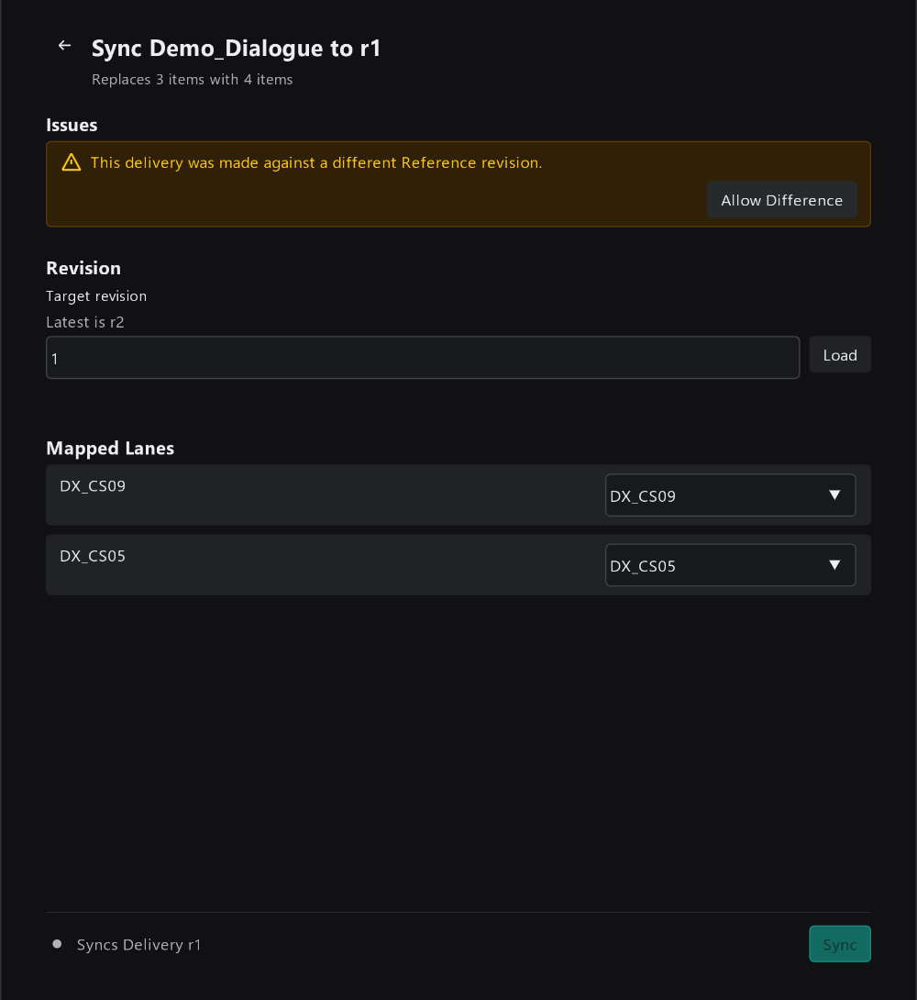
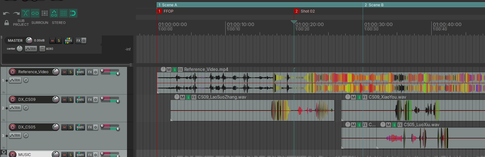
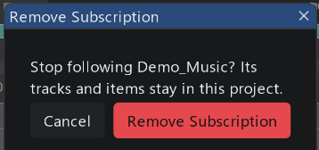

# 4. Master Project 日常操作

这一篇写给 Master Project 的负责人。假设你已经按 [3. 第一次完整走一遍](03-first-walkthrough.md) 建好了 Master 工程，发布过 Reference，并导入过至少一份 Delivery。

日常要做的事情主要有这几件：

| 场景 | 去哪一节 |
|------|---------|
| 画面或 Marker 改了，要发给各部门 | [重新发布 Reference](#重新发布-reference) |
| 新部门开始交付 | [再添加一份 Delivery](#再添加一份-delivery) |
| 某部门发布了新版本 | [检查和同步更新](#检查和同步更新) |
| 想知道在 Master 里改什么会被覆盖 | [在 Master 里可以改什么](#在-master-里可以改什么) |
| 把某段音频留在 Master 里自己用 | [把 Item 留作本地内容](#把-item-留作本地内容) |
| 新版本有问题，要退回旧版本 | [回退到旧的 Revision](#回退到旧的-revision) |
| 不再需要某份 Delivery | [移除订阅](#移除订阅) |

## 重新发布 Reference

画面换了新版本，或者加了新的镜头 Marker，都需要重新发布 Reference，各部门才能同步到。

### 第 1 步：更新内容并登记新增的部分

- **替换画面**：直接在已登记的 `Reference_Video` 轨道上替换视频 Item 即可。已登记的轨道上的变化会自动算进下一次发布。
- **新增 Marker / Region**：新加的 Marker 和 Region 需要**单独登记**。像第一次那样选中它，点 `Register`。

演示里新增了一个 `Shot 04` Marker。选中它，Selected 下显示 `Registered` 即说明登记好了。

> 不想再发给各部门的 Marker、Region 或轨道，选中后点 `Unregister`。下次发布时它就不在 Reference 里了。

### 第 2 步：发布

点 `Review and Publish`。标题会显示这次的 Revision 号（这里是 `Publish Reference r2`），Contents 里可以展开查看全部内容：

> 这个页面列出的是**发布后的完整内容**，不会标出和上一个 Revision 相比改了什么。发布前请自己确认改动是否都已登记。

确认后点 `Publish`。

**你应该看到：** Reference 卡片显示 `Published r2`。

注意右边 `Demo_Dialogue` 一行变成了黄色的 `Made Against Reference r1`：这份 Delivery 是对着旧画面做的。这只是提醒，不需要你在 Master 里做什么；对白部门同步 Reference r2 并重新发布后，提醒就会消失。

各部门不会被自动推送。他们下次打开 ReaProjectLink 时，会看到 `Reference r2 Available`，自己决定何时同步（见 [5. Source Project 日常操作](05-source-tasks.md)）。

## 再添加一份 Delivery

每个部门的 Source Project 都对应一份 Delivery。添加方法和第一次一样：点 Deliveries 卡片右上角的 `+`，选择那个部门工程旁边的 `_ReaProjectLink/<工程名>/delivery.json`。

这次演示把音乐 Delivery 放进 Master 里已有的 `MUSIC` 文件夹轨道：

1. 在 REAPER 里选中 `MUSIC` 文件夹轨道。
2. 在导入页面的 `New tracks go under` 选 `Selected Folder Track`。

**你应该看到：** 下方显示 `Under MUSIC`。如果选错了轨道，在 REAPER 里重新选中，再点 `Use Current Selection` 更新。

点 `Import`。底部提示 `Imported 2 items on 1 new track.`，新轨道出现在 `MUSIC` 文件夹里：

## 检查和同步更新

### 什么时候会检查

ReaProjectLink **不会**在后台定时检查。它在这些时候去读各部门发布的文件：

- 打开 ReaProjectLink 窗口时；
- 在 REAPER 里切换到这个工程的标签页时；
- 点右上角 `Check Now` 时；
- 某一行检查失败后，点那一行的 `Retry` 时。

右上角的 `Checked just now`、`Checked 3 min ago` 表示上次检查是什么时候。如果你知道某部门刚发布过，点一下 `Check Now` 即可。

### 发现更新

有部门发布了新版本时，Deliveries 卡片会显示 `1 Needs Attention`，对应一行显示 `r2 Available · Have r1`，并出现 `Sync` 按钮：

`Have r1` 是 Master 里现在用的版本，`r2 Available` 是对方最新发布的版本。

### 同步

点 `Sync`，进入同步检查页面：

- 标题 `Sync Demo_Dialogue to r2` 和副标题 `Replaces 4 items with 4 items` 说明：Master 里这份 Delivery 现有的 4 个 Item 会被删掉，换成 r2 的 4 个 Item。
- **Revision**：默认是最新版本。一般不用改。
- **Mapped Lanes**：每条 Delivery Track 导入到 Master 的哪条轨道，沿用上次的设置。

确认后点 `Sync`。

**你应该看到：** 底部提示 `Synced Delivery r2: replaced 4 items with 4 items.`，这一行变回 `Up to Date · r2`。

> 同步只修改工程，不会自动保存。确认没问题后，记得在 REAPER 里保存。如果同步完发现不对，可以直接用 REAPER 的撤销（`Ctrl+Z`），整次同步是一步撤销。

### 如果对方新增了 Delivery Track

如果对方新增了一条 Delivery Track，Master 不会自动导入它。这一行会显示 `1 Lane Not Imported` 和 `Map Lanes` 按钮，点进去会打开同步页面，在 Lanes 里为新的那条选择导入位置，再点 `Sync`。

## 在 Master 里可以改什么

要记住一条规则：**轨道归 Master，Item 归 Source。**

| 你在 Master 里做的事 | 同步新版本后 |
|---------------------|-------------|
| 调整轨道的音量、声像、FX、自动化、发送、颜色、名字 | **保留** |
| 把轨道挪进别的文件夹 | **保留** |
| 修改同步进来的 Item：移动位置、剪切、淡入淡出、Item 音量等 | **被替换**，改动会丢失 |
| 把同步进来的 Item 拖到别的轨道 | 会弹出提示，见下一节 |

原因是：每次同步都会把这份 Delivery 的全部 Item 删掉，换成新版本的完整内容，不会逐个合并修改。

所以：

- 混音工作放在轨道层面做，同步不会影响；
- 对白、音乐本身要改，请对应部门在 Source Project 里改好、重新发布；
- 真要在 Master 里改某段音频，先把它"留作本地内容"。

## 把 Item 留作本地内容

把一个同步进来的 Item 拖离它所在的轨道（比如从 `DX_CS09` 拖到 `DX_CS05`），ReaProjectLink 会弹出提示：

| 选择 | 结果 |
|------|------|
| `Keep as Local` | 这个 Item 变成 Master 自己的内容，以后同步不会再动它。底部提示 `Kept 1 moved item as local content.` |
| `Cancel` | 它仍然由 Source 管理。下次同步时会被删掉，换回新版本里对应的内容 |

留作本地内容之后，这份 Delivery 少了一个由它管理的 Item。下次同步页面会写成 `Replaces 3 items with 4 items`：删掉剩下的 3 个，导入完整的 4 个。

> 留作本地的 Item 不会再自动跟着 Source 更新，也不能重新变回由 Source 管理。如果之后想要回 Source 的版本，同步一次即可，Source 的版本会重新导入；但你留下的那个本地 Item **不会被删除**，两者会同时存在，需要你手动删掉不要的那个。

## 回退到旧的 Revision

如果某部门的新版本有问题，可以把 Master 里这份 Delivery 退回之前的 Revision。

### 第 1 步：打开同步到其他 Revision

点这一行右边的 `···`，选择 `Sync to Another Revision...`：

### 第 2 步：选择 Revision

在 `Target revision` 里填要退回的 Revision 号（比如 `1`），点 `Load`。页面会更新成这个 Revision 的内容：

如果那个 Revision 是对着旧版 Reference 做的，Issues 下会出现黄色提示 `This delivery was made against a different Reference revision.`，`Sync` 按钮暂时不能点。确认就是要用这个版本，点 `Allow Difference`，再点 `Sync`。

**你应该看到：** 这份 Delivery 换成了 r1 的内容。这一行显示 `r2 Available · Have r1`，提醒你还有更新的版本。等对方修好并发布新版本后，正常同步即可。

> 如果之前把这份 Delivery 的某个 Item 留作了本地内容，回退后可能出现**重复**：本地那个还在，同一段音频又从 r1 导入了一次。下图 `DX_CS05` 上就有两段重叠的 Item。请手动删掉不要的那个。
>
> 

## 移除订阅

不再需要某份 Delivery 时，点这一行的 `···`，选择 `Remove Subscription...`：

点 `Remove Subscription` 后，这一行从 Deliveries 卡片中消失，Master 不再检查它的更新。**已经导入的轨道和 Item 会留在工程里**，不会被删除；不需要的话，请手动删除。

> 移除订阅不会影响对方的 Source Project 和已发布的文件。以后想重新订阅，再 Add Delivery 一次即可。这会按第一次导入处理，之前留下的轨道和 Item 不会被接管，注意别导入重复。

## Deliveries 每一行的状态

| 状态 | 含义 | 你要做什么 |
|------|------|-----------|
| `Up to Date · r2` | 已经是最新版本 | 无 |
| `r2 Available · Have r1` | 对方发布了新版本 | 点 `Sync` 同步 |
| `1 Lane Not Imported` | 对方新增了 Delivery Track，还没选导入位置 | 点 `Map Lanes` |
| `Made Against Reference r1` | 这份 Delivery 是对着旧版 Reference 做的 | 无需操作；可提醒对方同步 Reference 后重新发布 |
| `Checking...` | 正在读取 | 等待 |
| `Couldn't Reach` | 访问不到对方发布的文件，通常是共享盘没连上 | 检查网络和共享盘，点 `Retry` |
| `Couldn't Read Delivery` | 文件读到了但内容有问题 | 点 `Retry`；仍不行，见 [6. 常见问题](06-troubleshooting.md) |

Deliveries 卡片顶部会汇总：全部正常时是 `All Up to Date`，有需要处理的是 `N Needs Attention`。
