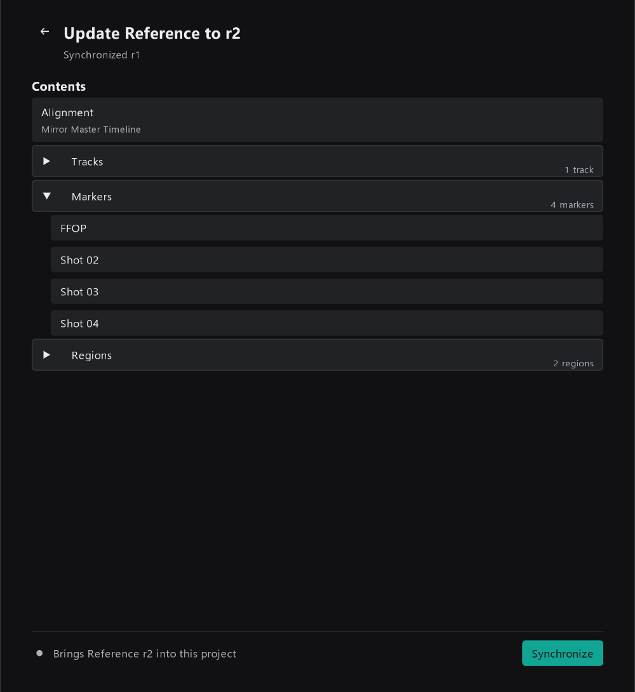
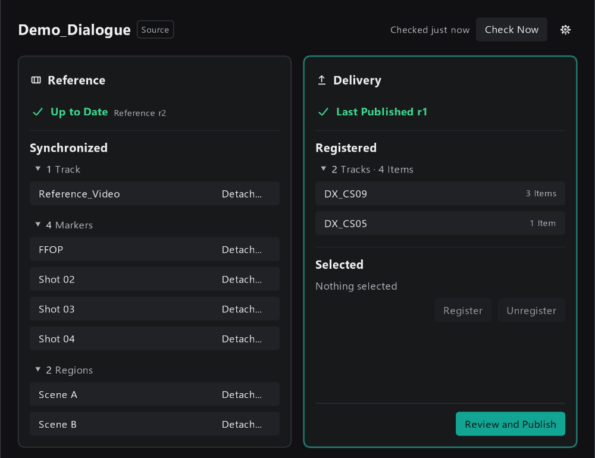
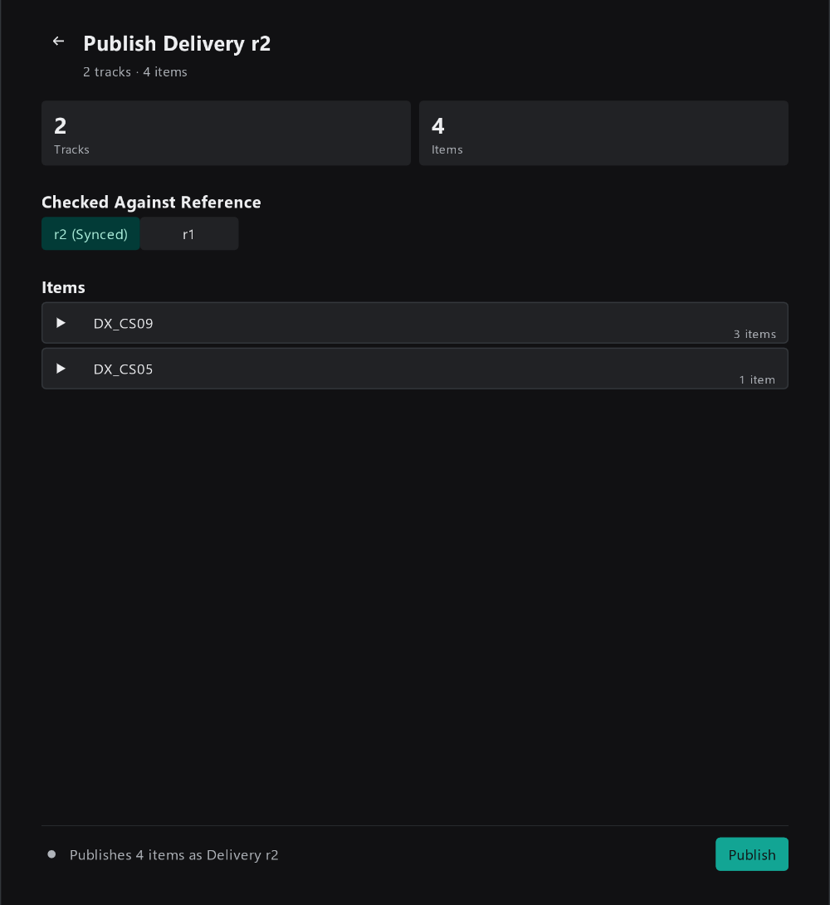

# 5. Source Project 日常操作

这一篇写给各部门（对白、音乐、音效等）的同事。假设你已经按 [3. 第一次完整走一遍](03-first-walkthrough.md) 建好了 Source Project，同步过 Reference，并发布过至少一次 Delivery。

日常要做的事情主要有这几件：

| 场景 | 去哪一节 |
|------|---------|
| Master 发布了新画面 / 新 Marker | [同步新的 Reference](#同步新的-reference) |
| 改完了，要交给 Master | [重新发布 Delivery](#重新发布-delivery) |
| 发布被拦下了 | [发布被拦下时](#发布被拦下时) |
| 要多交一条轨道，或者某条轨道不再交付 | [增加或减少 Delivery Track](#增加或减少-delivery-track) |
| 想自己改同步进来的画面或 Marker | [Detach：不再跟随 Reference](#detach不再跟随-reference) |

## 同步新的 Reference

### 发现更新

Master 发布了新的 Reference 后，你下次打开 ReaProjectLink 窗口、切换到这个工程，或点 `Check Now` 时，Reference 卡片会变成黄色的 `Reference r2 Available`，旁边的 `Synchronized r1` 是你现在用的版本：

注意右边 Delivery 卡片多了一行 `Will record Reference r1`：如果你现在不同步就发布，这次 Delivery 会被记录为"对着 r1 做的"，Master 那边会看到 `Made Against Reference r1` 的提醒。

> 不是必须马上同步。比如你正在赶一版对白，可以先按 r1 发布，之后再同步 r2。

### 同步

点 `Review Update`，进入同步检查页面：

这里列出 r2 的完整内容，点开分组可以看到具体名字。这个页面**不会**标出和 r1 相比改了什么，比如这里新增的 `Shot 04` 也没有特别标记；具体改动请找 Master 负责人确认。

确认后点 `Synchronize`。

**你应该看到：** 底部提示 `Synchronized Reference r2.`，Reference 卡片显示 `Up to Date Reference r2`，新的 `Shot 04` 出现在 Synchronized 下和时间线上。

> 同步只会更新由 ReaProjectLink 管理的画面轨道、Marker 和 Region，不会动你自己的轨道和 Item。

### 如果整段画面挪了位置

如果 Master 把整个 Reference 往前或往后挪了，同步页面会多出一个 Decision 区域，比如 `Move All Project Content 2.000 s Later`，并说明画面挪了多少。

- **勾上**：你工程里的 Item、Marker、Region 跟着一起挪，和新画面保持对齐。一般应该勾上。
- **不勾**：只更新画面，你自己的内容留在原位，可能就和画面对不上了。

## 重新发布 Delivery

在已登记的 Delivery Track 上正常工作：增删、移动、替换 Item 都可以，不需要重新 Register。改好后点 Delivery 卡片的 `Review and Publish`：

- 标题 `Publish Delivery r2`：这次会成为第 2 个 Revision。
- **Checked Against Reference**：这次是对着哪个 Reference 做的。同步过新 Reference 后，这里会出现两个选项：
  - `r2 (Synced)`：已经按新画面检查过对白位置，选这个；
  - `r1`：同步了 r2 但还没来得及按新画面检查，选这个，如实告诉 Master。

  只有一个可选的版本时，这里只显示一行 `Revision`，不需要选择。
- **Items**：点开每条轨道可以看到这次发布的文件名。

确认后点 `Publish`。发布期间顶部有进度，提示 `Edits made now will be in the next revision.`，意思是发布过程中你继续做的修改不会进这一版，会算进下一次发布。

**你应该看到：** 底部提示 `Published Delivery r2.`，Delivery 卡片显示 `Last Published r2`。Master 那边下次检查时就会看到 `r2 Available`。

> 每次发布都是一份**完整**的快照：Master 同步时，会把上一版的 Item 全部换成这一版。所以不用担心"只改了一个 Item 要怎么发"，照常发布即可。

## 发布被拦下时

Review 页面出现 Issues，底部显示 `Fix 1 issue to publish`，`Publish` 按钮不能点时，说明有问题要先解决。最常见的是交付轨道上挂了 FX：

| 提示 | 原因 | 怎么办 |
|------|------|-------|
| `DX_CS05 has Track FX.` | 交付轨道上挂了 FX。发布只复制 WAV 原文件，FX 效果不会带过去 | 把需要的效果 bounce 进 WAV，再删掉轨道上的 FX |
| `Track or Take FX were found. Published audio won't include them.` | 检测到 Track FX 或 Take FX | 同上。如果确定不需要这些效果，可以点 `Publish Unprocessed Media...` 继续，但 Track FX 仍需移除 |
| `<Item 名>: Media File Not Found` | Item 引用的文件找不到了 | 点 `Select Item` 在时间线上选中它，重新链接或替换文件 |
| `<Item 名>: Only file-backed WAV media can be published` | Item 不是 WAV 文件（比如 MP3、MIDI） | 把它 bounce 成 WAV |
| `<Item 名>: No active audio Take` / `Active Take has no file-backed media` | Item 是空的或没有对应的媒体文件 | 删掉它，或 bounce 成 WAV |
| `Synchronize a Reference revision before publishing.` | 还没同步过任何 Reference | 先同步 Reference |
| `1 Lane from Delivery r1 is no longer registered.` | 有 Delivery Track 被 Unregister 了 | 见下一节 |
| `This project was moved or saved under a new name. Is this the same delivery?` | 工程被另存或挪了位置 | 还是同一份交付，选 `Continue Existing`；要作为一份全新的交付，选 `Start New` |

处理完后，页面顶部会提示 `This project was edited after this review was made.`，点 `Refresh Review` 重新检查即可。

## 增加或减少 Delivery Track

### 增加

新建轨道，选中后在 Delivery 卡片点 `Register`。下次发布时就会带上它。

Master 那边不会自动导入新轨道：对应一行会显示 `1 Lane Not Imported`，需要 Master 负责人选择导入位置。新增轨道后请告诉他。

### 减少

选中不再交付的轨道，点 `Unregister`。下次发布时会被拦下，提示 `1 Lane from Delivery r1 is no longer registered.`，防止你误删。

确认要去掉它，点 `Publish Without Them...`，再确认一次。之后 Master 同步这一版时，就不会再收到这条轨道的内容。

> 去掉之后再重新 Register 同一条轨道，它会被当作一条**新的**轨道，Master 需要重新选择导入位置。如果只是暂时不想交付某条轨道的内容，可以把它的 Item 挪走，不要 Unregister。

## Detach：不再跟随 Reference

同步进来的画面轨道、Marker、Region 由 ReaProjectLink 管理，每次同步 Reference 都会被更新。如果你想自己改某一个，又不希望下次同步把它改回去，可以点它右边的 `Detach...`。

Detach 之后：

- 它留在你的工程里，变成你自己的内容；
- 以后同步 Reference 不会再改它；
- 下一次同步时，ReaProjectLink 会**再加一份**新的、由它管理的副本。

所以 Detach 之后可能会看到两份同名的 Marker 或两条画面轨道，按需删掉不要的那份。

> 大多数时候不需要 Detach。需要自己的 Marker，直接另外加一个就行，ReaProjectLink 不会动它。

## Source Project 的卡片状态

**Reference 卡片**

| 状态 | 含义 | 你要做什么 |
|------|------|-----------|
| `Up to Date Reference r2` | 已同步最新的 Reference | 无 |
| `Reference r2 Available` | Master 发布了新版本 | 点 `Review Update` |
| `Not Connected` | 还没订阅 Reference | 点 `Choose reference.json` |
| `Couldn't Reach Shared Storage` | 访问不到 Master 发布的文件 | 检查网络和共享盘，点 `Retry` |
| `Couldn't Read the Reference` | 文件读到了但内容有问题 | 点 `Retry`；仍不行，见 [6. 常见问题](06-troubleshooting.md) |

**Delivery 卡片**

| 状态 | 含义 | 你要做什么 |
|------|------|-----------|
| `Last Published r2` | 最近一次发布的是 r2 | 有新改动时点 `Review and Publish` |
| `Not Published Yet` | 已登记但还没发布过 | 点 `Review and Publish` |
| `No Delivery Tracks` | 还没登记任何交付轨道 | 选中轨道，点 `Register` |

> Delivery 卡片不会提示"你有还没发布的改动"。改完记得发布。
