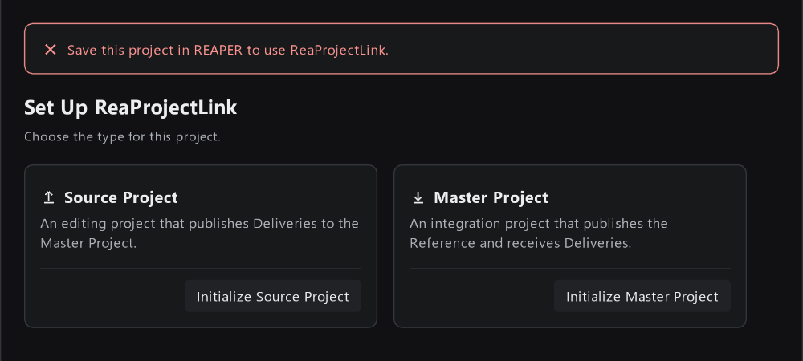

# 6. 常见问题

安装、更新、打不开窗口相关的问题，见 [安装与更新 ReaTools](../../../../../docs/manual/zh-CN/install.md#7-常见问题)。

## 打开窗口后

**只显示 `Save this project in REAPER to use ReaProjectLink.`**

工程还没保存过。先在 REAPER 里 `File > Save project` 保存到正式的位置，提示会自动消失。

> 初始化之前请想好工程放在哪里。Source Project 发布的文件会放在工程旁边的 `_ReaProjectLink` 文件夹里，Master Project 要能访问到这个位置。

**点 `Choose reference.json` 或 `Add Delivery` 后，文件对话框打开在 REAPER 的安装目录**

需要自己导航到对方工程所在的文件夹，再进入 `_ReaProjectLink/<工程名>/`。可以直接把路径粘贴到文件名输入框，按回车跳转。

## 检查更新时

**`Couldn't Reach` / `Couldn't Reach Shared Storage`**

访问不到对方发布的文件。通常是网络断了、共享盘没连上，或者对方的工程挪了位置。

1. 在文件资源管理器里打开对方工程所在的文件夹，确认能访问。
2. 回到 ReaProjectLink 点 `Retry`。

如果对方的工程确实换了位置：

- Source Project：在右上角齿轮进入 Settings，`reference.json` 那一栏点 `Change...`，重新选择；
- Master Project：请对方确认新的位置，再按 [4. Master Project 日常操作](04-master-tasks.md#移除订阅) 移除旧的订阅、重新添加。

**`Couldn't Read Delivery` / `Couldn't Read the Reference`**

文件能访问，但内容读不出来。可能的原因：

- 对方用了更新版本的 ReaProjectLink，发布了新格式的数据：按 [安装与更新](../../../../../docs/manual/zh-CN/install.md#5-更新) 升级到最新版；
- 有人手动改动或删除了 `_ReaProjectLink` 文件夹里的文件：联系对方重新发布。

> 不要手动修改、移动或删除 `_ReaProjectLink` 文件夹里的东西。里面的文件是给其他工程读取的，旧的 Revision 也可能还在被用。

**同步 Reference 时提示 `Reference media content does not match the published Reference Revision.`**

Master 那边在发布之后，用同名文件覆盖了画面视频。请 Master 负责人重新发布一次 Reference。

> 给 Master 负责人：换新版画面时，请用**新的文件名**，不要覆盖原文件。

**Master 的 Reference 卡片显示 `Package Missing`**

Reference 已发布的文件找不到了，通常是 `_ReaProjectLink` 文件夹被删除或挪走。点 `Review and Publish` 重新发布即可恢复。

## Review 页面

**提示 `This project was edited after this review was made.`**

打开 Review 之后，你又在工程里做了修改。点 `Refresh Review` 按最新的工程重新检查。

**底部显示 `Fix N issues to publish`，`Publish` 按钮不能点**

Issues 下列出了需要先解决的问题，常见原因和处理方法见 [5. Source Project 日常操作](05-source-tasks.md#发布被拦下时)。

**发布 Reference 时提示 `This Reference is identical to Reference r1.`**

和上一个 Revision 相比没有任何变化，不需要重新发布。如果你确实改了东西，检查新加的 Marker、Region 或轨道是否已经 `Register`。

## 发布中断

**发布到一半想停下**

发布进行中，顶部进度区有 `Cancel` 按钮。点了之后会显示 `Cancelling after the current file`，等当前文件复制完就停止。取消的发布不会生效，Master 看到的仍是上一个 Revision；之后点 `Retry` 或重新 `Review and Publish` 即可。

最后的收尾阶段（`Finishing`）不能取消，等它完成即可。

**发布中关闭了 ReaProjectLink 窗口**

会弹出 `Cancel Publish and Close` 确认：确认后取消这次发布、清理复制了一半的文件，再关闭窗口。不想取消就点 `Cancel`，等发布完成。

**提示 `Publishing is locked by <用户> on <电脑> since <时间>.`**

同一时间只允许一处在发布同一个工程。出现这个提示，说明：

- 有人（可能是你自己在另一台电脑上）正在发布这个工程：等对方完成；
- 或者上次发布时 REAPER 崩溃、断网，锁没有被清掉。

确认**没有任何人**在发布这个工程后，点 `Unlock Publishing...` 解锁，再重新发布。

## 同步之后

**Master 里改过的 Item 被还原了**

同步会把这份 Delivery 的全部 Item 换成新版本，Item 上的修改不会保留。见 [在 Master 里可以改什么](04-master-tasks.md#在-master-里可以改什么)。刚同步完的话，可以用 `Ctrl+Z` 撤销整次同步。

**同一段音频出现了两份**

通常是因为之前把它"留作本地内容"，之后又同步或回退了 Delivery。手动删掉不要的那份即可。见 [把 Item 留作本地内容](04-master-tasks.md#把-item-留作本地内容)。

**同步或导入之后，工程标题显示 `[modified]`**

同步和导入只修改工程，不会自动保存。确认没问题后，在 REAPER 里保存。

## 重新开始

如果一个工程的 ReaProjectLink 状态乱了，想从头再来：进入 Settings，在 Reset 下点 `Reset ReaProjectLink State...`。

- 会清除这个工程的类型、订阅、Revision 记录，以及轨道和 Item 上的 ReaProjectLink 标记，并删除这个工程已发布的文件；
- 工程里的音频、视频 Item 会保留；
- **不能用 REAPER 的撤销恢复。** 操作前请先另存一份工程。

> 如果其他工程订阅了这个工程发布的内容，Reset 之后他们会读不到。Reset 前请先和大家确认。

## 联系维护者时

在 Settings 的 Project 下，可以复制这个工程的 `Project File`、`Project ID` 等信息；About 下有 ReaProjectLink、REAPER、ReaImGui 的版本号。反馈问题时，请附上这些信息和出问题时的截图。
